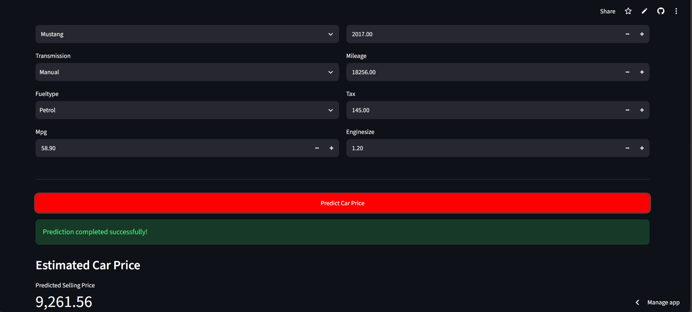

## 🚗 Used Car Price Prediction

A Machine Learning project that predicts the estimated selling price of used cars using **Hist Gradient Boosting Regression**.

## 📌 Project Overview

The objective of this project is to develop a machine learning model that estimates the selling price of a used car based on its specifications and features.

The project covers the complete machine learning workflow, from data preprocessing and model training to evaluation, model serialization, and web application deployment.

## 🖥️ Application Preview

Here is a screenshot of the deployed application:



## 🎯 Objectives

- Explore and preprocess used car data.
- Identify relevant features for price prediction.
- Train and compare multiple regression algorithms.
- Optimize the performance of the selected model.
- Build an interactive application for generating predictions.

## 🛠️ Technologies Used

- Python
- Pandas and NumPy
- Scikit-learn
- Joblib
- Streamlit
- Matplotlib

## ⚙️ Machine Learning Workflow

1. Data loading and exploration.
2. Data preprocessing and feature preparation.
3. Train-test splitting.
4. Training multiple regression models.
5. Model comparison using evaluation metrics.
6. Hyperparameter tuning using RandomizedSearchCV.
7. Saving the trained model using Joblib.
8. Building and deploying the Streamlit application.

## 🤖 Models Compared

The following regression algorithms were evaluated:

- Linear Regression
- Decision Tree Regressor
- Random Forest Regressor
- Extra Trees Regressor
- Gradient Boosting Regressor
- Hist Gradient Boosting Regressor

*Selected Model:* Hist Gradient Boosting Regressor

It achieved the best test-set performance among the evaluated models.

## 📊 Model Performance

The final tuned Hist Gradient Boosting model achieved the following results on the held-out test set:

| Evaluation Metric | Result |
|---|---:|
| R² Score | 0.9411 |
| MAE | 793.85 |
| MSE | 1,320,457.49 |
| RMSE | 1,149.11 |

The R² score indicates that the model explains approximately 94.11% of the variance in the test-set target values.

*Note: These results are based on the project's particular train-test split. Performance on new datasets may differ. Error values use the same price units as the original dataset.*

## 📁 Repository Structure

```text
car-price-prediction-/
│
├── app.py
├── car_price_model.joblib
├── requirements.txt
└── README.md
```

## 🚀 Run the Project Locally

## 1. Clone the repository

```bash
git clone https://github.com/Harshawasthi01/car-price-prediction-.git
```

### 2. Navigate to the project directory

```bash
cd car-price-prediction-
```

### 3. Install dependencies

```bash
pip install -r requirements.txt
```

### 4. Run the Streamlit application

```bash
streamlit run app.py
```

The application will open in your browser.

## 🌐 Live Application

[Open Used Car Price Prediction App](https://6wixp8wmlatwcnfv3rfx2k.streamlit.app/)

## 🔮 Future Scope

- Experiment with additional machine learning algorithms.
- Improve model generalization through cross-validation.
- Explore additional features that influence used car prices.
- Enhance the application's user experience.
- Evaluate performance on unseen real-world data.

## 👩‍💻 Author

**Tanu Sharma**
B.Tech – Computer Science and Artificial Intelligence & Machine Learning

GitHub: [tanuH14](https://github.com/tanuH14)

---

*This project was developed as a hands-on learning experience in Machine Learning, regression modeling, and application deployment.*
